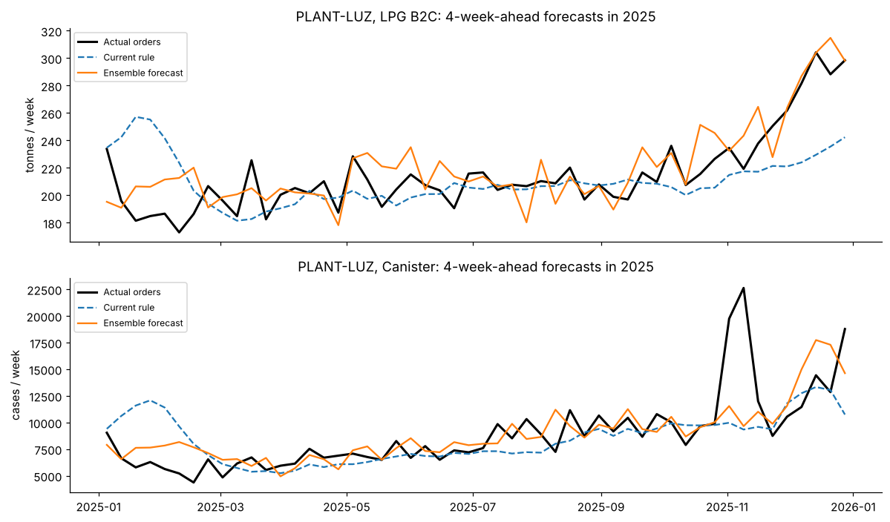
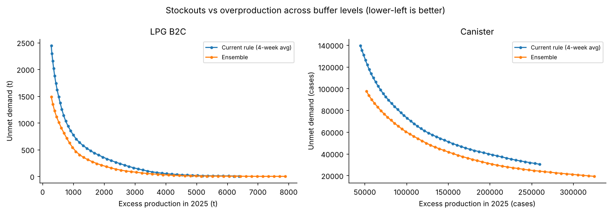

# LPG & Canister Demand Forecasting and Production Planning

**How much will LPG dealers and canister distributors order in the next 4 weeks, and how many cylinders and canister cases should each plant prepare?**

I forecast weekly orders for each plant, 4 weeks ahead, and compared the forecasts with the plant's current rule (produce last month's average). For LPG B2C the forecast cuts December error from **21.4% to 5.7%**. For the same overproduction, it leaves **30% less unmet demand** across the year.

> ⚠️ **All data is simulated.** Company data is confidential, so `src/lpg/simulate.py` generates a realistic Philippine LPG business (3 plants, 12 regions, about 620 accounts, 60,000 plant visits, 2023-2025). Region names are real; volumes, households and accounts are not. The code runs on real gate-log data with the same columns. **Never commit company data.**

| Business line | Customers | Unit | How it is planned |
|---|---|---|---|
| **LPG B2C** | dealers | cylinders (2.7 / 11 / 22 / 50 kg) | **analysed here** |
| **Canister** | canister distributors | cases (28 cans x 220 g) | **analysed here** |
| **LPG B2B** | restaurants, hotels, industry | cylinders | SPANCOP sales pipeline (committed orders) |



## Results (2025 backtest, 4 weeks ahead)

| | LPG B2C | Canister |
|---|---|---|
| 2025 volume | 17.3 kt (+13% YoY) | 662k cases (+11% YoY) |
| Peaks | December, paydays; dip in Holy Week | Typhoon season (Jul-Nov, brownouts) and December |
| Forecast error (WAPE): current rule | 10.4% (December 21.4%) | 24.7% |
| Forecast error (WAPE): ensemble | **8.8%** (December **5.7%**) | **22.9%** |
| Unmet demand at the same overproduction | **30% less** | **18% less** |
| December 2025 unmet demand | 348 t to **14 t** | 15.0k to **5.5k** cases |

**Highlights**
- **Forecast orders, not withdrawals.** Withdrawals are capped by stock, so training on them hides the demand lost to stockouts.
- **Canisters need their own plan.** They peak in typhoon season as well as December, and typhoon weeks cannot be predicted 4 weeks ahead. I recommend a monthly canister plan, building stock before July, and an override when PAGASA issues a typhoon warning.
- The forecast becomes a concrete plan: **cylinders per size** for LPG B2C and **cases** for canisters. B2B volume is added from the SPANCOP pipeline (Order and Payment stages as firm volume).



## Approach

1. Weekly ordered tonnes for each plant x line (LPG B2C, Canister), 2023-2025
2. Features at least 4 weeks old: lags relative to the recent level, year-on-year growth, week of year, paydays, holidays, the December run
3. Models: the current rule, same week last year x growth, LightGBM, and a LightGBM + seasonal ensemble
4. Evaluation: WAPE on all 52 weeks of 2025, plus a stockout-vs-overproduction trade-off curve across buffer levels

**Part of my LPG analytics series** (all simulated data, same simulated business):
1. [LPG & Canister Demand Forecasting](https://github.com/CatherineTugado/lpg-canister-demand-forecasting): how much to produce
2. [Dealer Return & Refill Prediction](https://github.com/CatherineTugado/lpg-dealer-return-refill-prediction): when customers come back
3. [Regional Demand & Growth](https://github.com/CatherineTugado/lpg-regional-demand-growth): where to grow

## Project structure

```
├── data/simulated/                        # generated by src/lpg/simulate.py
├── notebooks/01_volume_forecast_production.ipynb
├── src/lpg/simulate.py | forecasting.py
├── reports/figures/
├── tests/                                 # data consistency + no-leakage tests
└── requirements.txt
```

